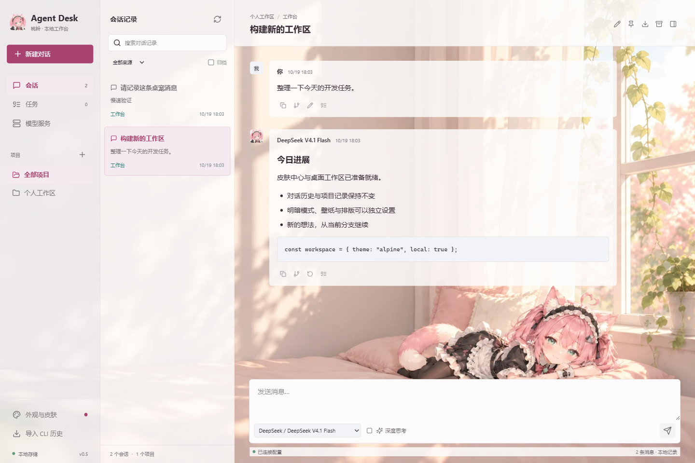

# Agent Desk

**让 AI 对话有地方安放，让未完成的任务下次接着做。**

Agent Desk 是带桃铃桌宠的本地 AI 会话与任务工作台。把 Claude Code / Codex CLI 历史、
多模型聊天、项目和待办整理到同一个窗口，搜索旧记录，从原对话分支继续，或者回到 CLI 接着做。

[下载 Windows 桌面版](https://github.com/nanyun818/agent-desk/releases/latest) ·
[源码](https://github.com/nanyun818/agent-desk) · [安装指南](docs/DOWNLOAD.md) ·
[对外介绍文案](docs/INTRODUCTION.md)



版本：0.5.2，早期体验版，本地单用户，提供网页版和 Windows x64 桌面版。
安装包自带运行时，无需安装 Node.js 或打开命令行。其他平台暂无安装包。

## 为什么做它

- 昨天在 CLI 里做了一半的任务，今天能通过搜索、项目和历史记录找到。
- GPT、Claude、DeepSeek、Kimi、通义千问及兼容接口，在一个工作台中管理。
- 想试另一个方向，可以从消息分支，保留原对话；文件回退使用手动快照和差异预览。
- 换肤、壁纸与透明度可调；桃铃可以摸头、直接拖动身体，点击身体打开随手聊。
- 历史、任务和设置保存在本机；仅在发送消息时把当前分支正文发给选定模型服务商。

**软件免费，不赠送模型额度。** 需要自行配置对应服务商的 API Key，并承担其 API 费用。
ChatGPT / Claude 网页或 CLI 订阅不等于本工具的 API 额度。
目前是文本聊天与历史管理工作台，不会自动执行命令、编辑项目文件或调用 MCP 工具。

品牌角色：桃铃（Taoling），昵称桃桃。用户认可的原创粉色猫娘女仆形象，
统一用于默认皮肤、聊天头像、应用和托盘图标、独立 mini 桌宠。
角色规范及资产来源见 `design/mascot/TAOLING.md`。

技术栈：React + Express + SQLite，Node.js 24+，程序代码为 MIT 许可，插画使用范围见 `ASSETS.md`。

## 启动

普通用户：到 [Releases](https://github.com/nanyun818/agent-desk/releases/latest)，
下载 `Agent-Desk-Setup-0.5.2-x64.exe`，不要下载 `Source code (zip)`。
双击安装到当前用户，
随后双击桌面或开始菜单中的 **Agent Desk**。安装包自带 Node.js 后端运行时，不依赖系统 Node.js，
没有命令行窗口。桌面和网页版共享 `%LOCALAPPDATA%\AgentDesk` 的记录与密钥库。
关闭桌面版时只停止它自己启动的后端；如果复用了已运行的网页版服务，会保留该服务。

首次启动，在“模型服务”配置自己的 API 地址、密钥和模型，再新建对话。
安装包目前未做代码签名；下载后请核对发布者、文件名与 SHA-256。
如遇系统拦截，不要关闭安全软件或忽略检测结果，先按 [安装指南](docs/DOWNLOAD.md)核验。

从源码开发桌面版：`npm run desktop`（先构建网页，系统需 Node.js 24+）。
打包安装程序：`npm run desktop:build`。构建产物为本地未签名安装包。

Windows 双击 `Start-AgentDesk.cmd`。服务在后台运行，启动器可重复运行以重新打开页面。
默认地址为 http://127.0.0.1:4317，端口被占用时自动递增，实际地址以启动器输出为准。

```powershell
npm ci
npm run build
npm start
```

开发：`npm run dev`。验证：`npm test`、`npm run build`。

## 已实现

- 项目分类；按消息正文、标题、模型和目录搜索；来源筛选、置顶、重命名、归档。
- 原始 Claude Code、Codex CLI JSONL 历史只读导入；重复导入更新记录而不重复创建。
- 复制 PowerShell CLI 恢复命令；把历史复制为工作台分支后通过 API 续聊。
- GPT（OpenAI Responses）、Claude（Anthropic Messages）、DeepSeek、Kimi、通义千问预设。
- 自定义服务商支持 Chat Completions、OpenAI Responses、Anthropic Messages 三种协议。
- 服务商、模型切换；流式回复、停止、思考内容折叠、Markdown 导出。
- 从任意消息分支；修改用户消息后分支；重新生成时自动保留原对话。
- 任务待办/进行中/完成状态，关联会话，任务看板。
- 手动文件快照、逐文件差异、恢复前校验、自动恢复前备份及撤销恢复。
- 十套皮肤；原创“桃铃 · 午后小憩”为默认；简洁暖光全窗口背景，人物趴在画面一角。
- 桌面版独立透明 mini 桃铃：原生拖动、缩放、隐藏、轻动效及思考/完成/错误状态反馈。
- 摸头切换开心表情、轻动与爱心动画；累计摸头次数保存在本机，重启后保留。
- 点击桌宠身体打开随手聊：模型切换、流式回复、停止、最近对话续聊、一键回到主工作台。
- 全景主题铺满应用窗口，旧角色主题仍可保留独立插画区域；字号、强调色和密度可调。
- 本地壁纸导入与压缩、独立玻璃模糊/壁纸模糊/压暗/不透明度调整；重启或换端口保留外观。
- Agent Desk JSON 皮肤包导入导出；兼容 Harness 的 seeds 配色 JSON 子集。

## 外观与皮肤

点击左下角“外观与皮肤”，选择皮肤并调整外观，点击“保存外观”持久化到本地 SQLite。
未保存的预览在离开页面后取消。导出只包含当前皮肤的配色与可用壁纸，不包含 API Key、对话
或项目数据；内置壁纸会打包为本地图片数据。导入后的自定义皮肤上限为 24 套，可单独删除。

桌面版同页的“桌面伙伴”可显示/隐藏桃铃、调整大小和暂停动效，设置立即保存到
`%LOCALAPPDATA%\AgentDesk\companion.json`。桌宠支持拖动并记住位置，不抢输入焦点；
托盘与“查看”菜单也可重新显示。脑袋是摸头区域；身体轻点打开随手聊，按住直接拖动。
移动超过 6 个屏幕坐标像素后视为拖动，松手不会误开聊天；轻微手抖仍视为点击。
拖动后立即保存位置，并限制在显示器工作区内；悬停出现的小手柄仍可作为备用拖动入口。
移动时始终重新传入设置中的宽高，避免 Windows 分数 DPI 下位置更新引发尺寸累积误差。
摸头次数在同一 JSON 文件的 `pats` 中，不通过模型接口计数。轻动暂停不阻止主动摸头反馈；
系统减少动态效果偏好会停用运动效果。当前为双表情图片、轻量图层动画和状态提示，
不是 Live2D，也没有逐帧行走。

随手聊与工作台共用本机后端、API 配置和对话数据库，聊天依照选中服务商的 API 计费；
不会自动发送消息。小窗可以切换最近工作台对话或新建对话，切模型会携带已有分支上下文。
收起聊天窗只隐藏窗口，正在生成的回复继续进行；停止按钮可中断。关闭主窗口会同时退出
聊天窗与桌宠，保留已保存的消息。小窗没有配置密钥、执行命令或读取任意文件的原生桥接。
角色不会更改模型人格、系统提示词或 API 服务商。

图片仅支持 PNG/JPEG/WebP，源文件不超过 20 MB，浏览器本机缩放至最长边 1920 像素、
压缩为 WebP 后保存（上限 2 MB）。不加载远程壁纸、SVG、脚本、CSS、npm 插件或 DSH
安装包。兼容的 Harness JSON 需要 `name`、`appearance` 和 `seeds` 中的 `accent`、
`secondary`、`surface`、`text` 四个 #RRGGBB 颜色；不是完整 DSH 插件运行环境。

参考 dsh-deep-whale、dsh-web-ui、Transparent UI、dsh-tui 的不同界面方向；没有直接搬入其
插件源码或美术。两套经典配色仅适配 HeiGeAi MIT 项目的纯色种子，并保留署名与许可证，
见 [第三方说明](THIRD_PARTY_NOTICES.md)。山湖壁纸为本项目原创生成资产，来源与完整提示词
见 `public/wallpapers/provenance.json`。所有主题都检查正文、次级文字与按钮对比度；壁纸和透明度
仍会影响最终感受，用户可把不透明度调至 100% 使正文区域恢复不透明底。

## 模型

在“模型服务”中配置服务商自己的 API Key。已有 DeepSeek Claude Code 配置仅在其
`ANTHROPIC_BASE_URL` 主机为 `api.deepseek.com` 时复用，密钥不发送给浏览器。
也可读取 `DEEPSEEK_API_KEY`、`MOONSHOT_API_KEY`/`KIMI_API_KEY`、`DASHSCOPE_API_KEY`。
官方 GPT 使用 `OPENAI_API_KEY`，官方 Claude 使用 `ANTHROPIC_API_KEY`，也可在模型服务页保存。
Claude 的官方接入不会复用指向 DeepSeek 的 `ANTHROPIC_AUTH_TOKEN`，也不会读取 Codex/Claude
CLI 的 OAuth 订阅令牌。不同服务商的密钥与 Base URL 需要对应。
预设模型可手工修改，或从服务商获取模型列表。Kimi Coding 订阅密钥与 Moonshot 按量 API
属于不同服务，需使用与 Base URL 配套的密钥。自定义接口可接入具有 Chat Completions
端点的本地服务；本地无鉴权服务取消勾选“接口需要 API Key”。

聊天仅在用户发送时将当前分支的对话正文发给选定服务商；导入、搜索、任务和快照均在本机完成。
切换模型会携带该分支已有的对话正文。工作台聊天当前没有自动执行命令、编辑文件或调用 MCP
工具的能力；执行代码任务可复制原 CLI 恢复命令回到 CLI。导入历史不会复现工具执行状态。
当前为文本对话，不提供附件、图像理解或跨设备同步。

参考：[DeepSeek](https://api-docs.deepseek.com/quick_start/agent_integrations/)、
[Moonshot](https://platform.moonshot.cn/docs)、[通义接口](https://help.aliyun.com/zh/model-studio/base-url)。
官方协议：[OpenAI Responses](https://developers.openai.com/api/docs/guides/streaming-responses)、
[Claude Messages](https://platform.claude.com/docs/en/build-with-claude/streaming)。
预设模型 ID 以官方文档为基线，可在配置页修改或通过“获取模型列表”更新到自己账户可用的模型。

## 文件回退范围

为项目绑定具体的本地文件夹后，可创建快照。快照最多包含 500 个文件 / 30 MB，单文件不超过
5 MB，遵守根目录 `.gitignore`，跳过符号链接、依赖、构建产物、`.env`、常见密钥及数据库文件。
这是受限的文件内容快照，不是完整系统备份；不保留 ACL、目录状态、重命名关系或全部文件元数据。

恢复只处理被快照记录的文件，不删除后来新增且未纳入快照的文件。恢复前展示改动，检查预览后
文件是否变化，并创建恢复前快照；选择这份自动快照可以撤销恢复。已丢失的快照文件会重新创建，
其撤销快照会记录“原先不存在”，撤销时只删除该恢复操作新建的文件。文件写入使用同目录临时
文件后替换。外部编辑器/CLI 没有被锁定，并发修改可能使恢复中止，需要重新预览。
快照是手动创建的，历史 CLI 会话中此前的文件修改无法追溯恢复。

## 数据和运行

默认数据目录 `%LOCALAPPDATA%\AgentDesk`（可用 `AGENT_DESK_DATA_DIR` 覆盖），包含 SQLite、
本机密钥库密钥、运行日志与进程标记。保存的 API Key 使用 AES-256-GCM 加密；解密密钥在同一
用户数据目录的 `vault.key`，依赖本机账户和文件权限保护，不等同于独立硬件密钥库。
数据库保存本地对话和文件快照，属于私有数据；备份整个数据目录并妥善保管。

服务只监听 `127.0.0.1`，检查 Host、Origin，API 使用每次启动随机的会话令牌。
不提供公网账户体系；不要将此服务通过端口转发或反向代理暴露到互联网。
关闭网页不会删除记录。浏览器关闭会中断该页面正在进行的回复；重新打开后可查看已保存内容。
首版历史导入为手动触发，每次最多 1200 个 JSONL 文件、160 MB，单文件不超过 30 MB；
超过上限的文件不会被删除，但也尚未进入索引。只导入 Claude/Codex 的正文与工具调用名称。

停止后台服务：运行 `Stop-AgentDesk.ps1`，它会核对 PID 和本项目入口后停止该进程。
无需停止服务来关闭页面；再次双击启动器会复用已运行的实例。

## 参与与许可

欢迎提交问题和改进，见 [贡献指南](CONTRIBUTING.md)、[安全说明](SECURITY.md)。
程序代码使用 [MIT](LICENSE)；角色插画与品牌形象另见 [美术资产说明](ASSETS.md)，
第三方内容见 [THIRD_PARTY_NOTICES.md](THIRD_PARTY_NOTICES.md)。
本项目不是 OpenAI、Anthropic、DeepSeek、Moonshot 或所参考游戏的官方产品。
